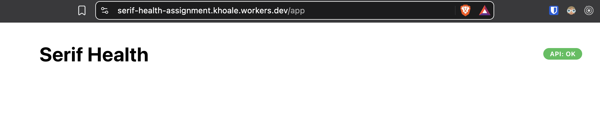

# Serif Health
## Price Transparency Explorer
[Demo App](https://serif-health-assignment.khoale.workers.dev/app)

A small full-stack app for searching an insurer's negotiated rates by billing code.

## Goal

I take a CMS Transparency in Coverage index file (Centene / Fidelis), use it to pick an in-network rate file, and make that file searchable.

1. **Index**: Find an in-network rate file URL in the index.
2. **Ingest**: Fetch the rate file and flatten its nested JSON into simple rows: billing code, description, provider NPI/EIN, negotiated rate, and source file.
3. **API**: `GET /search?code=<billing_code>&npi=<npi>&ein=<ein>`. The billing code is required; NPI and EIN are optional filters.
4. **UI**: Search by billing code, narrow by NPI/EIN, and view the results in a clean table.
5. **Resilience**: Show fetch and parse errors in the UI instead of crashing.

## Scope

- Data is kept in memory, with no database.
- The rate file is picked by hand from the index.
- I timeboxed the work to about 3 hours.

## Setup

_Coming soon._

# Timeline
2026-11-22 Setup scaffold, backend and ui


## Understanding the structure
Each JSON file is very large so the first step is understanding the key paths and the schema skeleton of the file.
→ Add `make explain-file` command to print out the unique key paths
```txt
➜  serif-health git:(main) ✗ make explain-file FILE=/path/2026-08-31_centene-management-company-llc_fidelis-es_in-network.json
in_network[].billing_code: string
in_network[].billing_code_type: string
in_network[].billing_code_type_version: string
in_network[].description: string
in_network[].name: string
in_network[].negotiated_rates[].negotiated_prices[].additional_information: string
in_network[].negotiated_rates[].negotiated_prices[].billing_class: string
in_network[].negotiated_rates[].negotiated_prices[].billing_code_modifier[]: string
in_network[].negotiated_rates[].negotiated_prices[].expiration_date: string
in_network[].negotiated_rates[].negotiated_prices[].negotiated_rate: number
in_network[].negotiated_rates[].negotiated_prices[].negotiated_type: string
in_network[].negotiated_rates[].negotiated_prices[].service_code[]: string
in_network[].negotiated_rates[].negotiated_prices[].setting: string
in_network[].negotiated_rates[].provider_references[]: number
in_network[].negotiation_arrangement: string
last_updated_on: string
provider_references[].network_name: array
provider_references[].provider_group_id: number
provider_references[].provider_groups[].npi[]: number
provider_references[].provider_groups[].tin.business_name: string
provider_references[].provider_groups[].tin.type: string
provider_references[].provider_groups[].tin.value: string
reporting_entity_name: string
reporting_entity_type: string
version: string

```

→ In-memory won't scale. A 176MB, 3.3M-line JSON file becomes roughly 1–2GB of Python objects. Loading it into memory is slow and gets re-done every session. A persisted, indexed store is better.

## Makefile
### Make help
```bash
➜  serif-health git:(main) ✗ make help
Targets:
  install  Install API and UI dependencies (use Node 22: nvm use)
  dev      Run the Workers API (:8787) and the React UI with hot reload
  deploy   Build the UI and deploy the Worker (serves API + UI)
  explain-file  Print unique key paths of a large JSON file (FILE=path/to.json)
  d1-migrate  Apply api/migrations to D1 (add LOCAL=1 for local)
  migrate-file-to-d1  Load a big JSON file into D1 (FILE=path [LIMIT_ITEMS=n] [LIMIT_PROVIDERS=n] [START_ITEM=n] [LOCAL=1])
  nuke-dev-db  Delete ALL rows from the D1 tables, keeping the schema (LOCAL=1 for local; CONFIRM=yes skips the prompt)
  help     Show this help message
```

### Migrate the downloaded JSON to D1 sqlite database
```bash
serif-health git:(main) ✗ make migrate-file-to-d1 FILE=/<PATH>2026-08-31_centene-management-company-llc_fidelis-es_in-network.json
Providers (provider_references[])
  groups: 1908 (86/s)))
Billing items (in_network[])
  items: 2530 (11/s)
  last item_id processed: 2529
Done in 243s, 73 batches.
```

